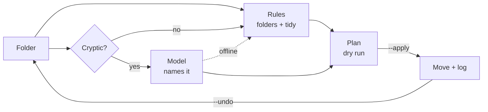

# slothsort

**Sort your mess while you sleep — with an open-weight model running on your own machine.**

`slothsort` takes a messy folder (Downloads, Desktop, a shared drive), files
everything into clean type folders, and — the part rules can't do — reads the
documents with meaningless names (`scan_001.pdf`, `report_final_v2 (1).docx`)
and gives them names a human would recognize. It runs on any OpenAI-compatible
endpoint backed by an open-weight model (Ollama, LM Studio, llama.cpp, vLLM)
and falls back to deterministic rules when no model is reachable.

Built for the [Hacktoberfest Open-Source AI Challenge: Week 3 — Slow and Steady](https://dev.to/challenges/hacktoberfest-week3-2026-10-19).

## Why this exists

Every download folder turns into the same archaeology site: three versions of a
report, a scan you don't remember making, an invoice named after the scanner.
Sorting it by hand is twenty minutes of tiny decisions you keep postponing.

`slothsort` is built for exactly that twenty minutes — the kind of work you do
at 1 a.m. or never. Run it before bed, wake up to folders that make sense. The
slow part (a 3B model reading your documents one by one) happens while you
sleep, which is the whole point of the theme.

## Install

```bash
git clone https://github.com/Mystical89/slothsort
cd slothsort
python3 slothsort.py ~/Downloads          # dry run — shows the plan
```

Python 3.10+, no dependencies. `pdftotext` (poppler-utils) is optional — it
lets the model read PDFs; without it PDFs are still sorted, just not renamed.
`.docx`, `.pptx`, `.xlsx` and plain text are read with the standard library.

## Usage

```bash
# see the plan, move nothing
slothsort.py ~/Downloads

# do it
slothsort.py ~/Downloads --apply

# change your mind
slothsort.py ~/Downloads --undo

# no model: rules only, instant
slothsort.py ~/Downloads --offline --apply

# any OpenAI-compatible server
slothsort.py ~/Downloads --base-url http://127.0.0.1:8080/v1 --model qwen2.5:3b

# machine-readable plan
slothsort.py ~/Downloads --json
```

## Nightly run

The repo ships a `systemd --user` unit pair that tidies `~/Downloads` at 03:00:

```bash
mkdir -p ~/.config/systemd/user
cp systemd/slothsort.service systemd/slothsort.timer ~/.config/systemd/user/
systemctl --user daemon-reload
systemctl --user enable --now slothsort.timer   # turn off: disable --now
journalctl --user -u slothsort                  # what it did last night
```

Edit `ExecStart` in `systemd/slothsort.service` if your checkout or target folder differs.

## Real output (one run — the model's exact name varies between runs)

Dry run on the 14-file demo folder (`demo/make_demo.py`), with `qwen2.5:3b` on
Ollama:

```console
$ slothsort.py demo/messy

slothsort · /home/mystical/projects/slothsort/demo/messy  (14 files, 4.0 KB)

  Documents/
    contract_2026.pdf                                                      [rules]
    notes.md                                                               [rules]
    receipt_2026-10-03.txt                                                 [rules]
    report_final_v2 (1).docx  →  q3-2026-report.docx                       [model]
    scan_001.pdf  →  acme-energy-bill.pdf                                  [model]
  Spreadsheets/
    data.csv                                                               [rules]
  Images/
    IMG_2041.jpg                                                           [rules]
    photo_2026-09-30.jpg                                                   [rules]
  Screenshots/
    Screenshot from 2026-10-18 14-22-31.png  →  screenshot-from-2026-10-18-14-22-31.png [tidy]
  Audio/
    song.mp3                                                               [rules]
  Archives/
    archive_old.tar.gz                                                     [rules]
    backup.zip                                                             [rules]
  Installers/
    Qoder-linux-amd64.deb                                                  [rules]
  Code/
    main.py                                                                [rules]

Plan: 14 files → 8 folders, 3 renames. Dry run — nothing moved. Use --apply.
```

`--apply` moved those 14 files in **10.6 s** (warm model). A cold start costs
another ~60 s while the 3B model loads into RAM. Undo restored all 14 in one
command.

## What the model does — and what it doesn't

| Job | Who does it | Why |
|---|---|---|
| Folder by file type | rules | an extension is not a guess |
| Junk-name cleanup (`Screenshot from … (1).png`) | rules | deterministic, no model needed |
| Name a document from its content | **model** | this is the part that needs reading |

The model only sees files it can read (PDF, DOCX, PPTX, XLSX, text). Images,
archives and binaries are never sent anywhere — and nothing is sent anywhere
at all: the endpoint is `127.0.0.1` by default.

## Safety

- **Dry run by default.** Files move only with `--apply`.
- **Never deletes.** Everything is moved, nothing is removed.
- **Never overwrites.** A name collision becomes `file (2).pdf`.
- **Undo.** Every run writes a JSON log to `.slothsort/runs/`; `--undo`
  reverses the last one.
- **Skips** hidden files, symlinks and the log directory.
- **Falls back to rules** if the model endpoint is down — the tool still works.

## How it works



1. Scan the folder (top level, up to `--max` files, default 40).
2. Sort by extension into `Documents/`, `Images/`, `Archives/`, …
3. For each file with a cryptic name that we can read, take the first ~200
   characters of text and ask the model for a kebab-case name:
   `scan_001.pdf` + "ACME ENERGY Electricity bill…" → `acme-energy-bill.pdf`.
4. Show the plan. With `--apply`, move the files and write the undo log.

The prompt asks for the name only — one short answer per file, no JSON to
parse, no batch ids to mismatch. On a 4.5 W laptop that is the difference
between a tool that works and one that hallucinates file names.

## Performance

Measured on an Intel Core m5-6Y57 (2 cores / 4 threads, 7.2 GB RAM, CPU-only)
with `qwen2.5:3b`:

- cold run, model loading: ~60 s for 14 files;
- warm run: ~10 s;
- `--offline`: under a second.

Slow and steady is the point: this is a tool for the night shift, not for
interactive clicking.

## Tests

```bash
python3 -m unittest -v test_slothsort.py
```

25 tests, no network and no model required — parsing, rules, planning, apply,
dedupe and undo are all covered with a fake chat function.

## License

[MIT](LICENSE)
