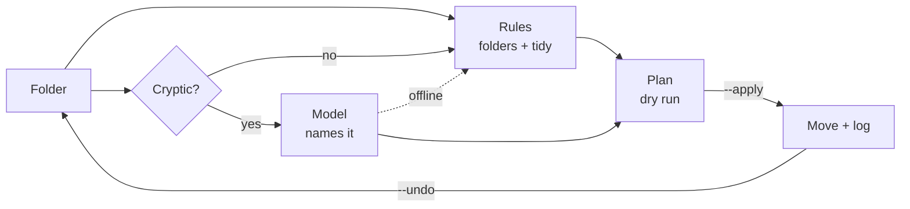

*This is a submission for the [Hacktoberfest Open-Source AI Challenge Week 3: Slow and Steady](https://dev.to/challenges/hacktoberfest-week3-2026-10-19)*

*A note before we start: I'm in Belarus, and the official rules exclude residents of Belarus and Russia from prize eligibility. I know I'm not competing for the cash — I'm taking part just for fun, the badge, and the practice. The work below stands on its own.*

## What I Built

**slothsort** — a CLI that sorts your mess while you sleep.

Rules move files into type folders. A 3B open-weight model, running locally through Ollama, does the part rules can't: it reads the documents whose names tell you nothing and gives them names a human would recognize.

The problem is a specific kind of procrastination. `scan_001.pdf`. `report_final_v2 (1).docx`. `Screenshot from 2026-10-18 14-22-31.png`. You know you should sort them. You also know that sorting them means opening each one to find out what it is — which is exactly the twenty minutes you never have. So the folder grows.

slothsort flips the order: you run it before bed, and the machine does the opening. In the morning the scan is `acme-energy-bill.pdf`, the report is `q3-2026-report.docx`, and everything sits in a folder that makes sense.

Who gets to be a little lazier: anyone with a Downloads folder. Which is everyone.

## Demo

```console
$ python3 slothsort.py demo/messy

slothsort · /home/mystical/projects/slothsort/demo/messy  (14 files, 4.0 KB)

  Documents/
    contract_2026.pdf                                                      [rules]
    notes.md                                                               [rules]
    receipt_2026-10-03.txt                                                 [rules]
    report_final_v2 (1).docx  →  q3-2026-report.docx                       [model]
    scan_001.pdf  →  acme-energy-bill.pdf                                  [model]
  Spreadsheets/
    data.csv                                                               [rules]
  Images/
    IMG_2041.jpg                                                           [rules]
    photo_2026-09-30.jpg                                                   [rules]
  Screenshots/
    Screenshot from 2026-10-18 14-22-31.png  →  screenshot-from-2026-10-18-14-22-31.png [tidy]
  Audio/
    song.mp3                                                               [rules]
  Archives/
    archive_old.tar.gz                                                     [rules]
    backup.zip                                                             [rules]
  Installers/
    Qoder-linux-amd64.deb                                                  [rules]
  Code/
    main.py                                                                [rules]

Plan: 14 files → 8 folders, 3 renames. Dry run — nothing moved. Use --apply.
```

`--apply` moved all 14 files in **10.6 s** with a warm model. Then:

```console
$ python3 slothsort.py demo/messy --undo
Undone 14 moves from run 20261020-213040.
```

The exact name the model picks varies between runs — a later run called the same scan `electricity-bill-2026.pdf` — but the shape of the plan doesn't.

The demo folder is generated by `demo/make_demo.py` — an invoice PDF, a contract, a docx report, screenshots, archives, a `.deb` — so you can reproduce the whole thing in one command.

## Code

[github.com/Mystical89/slothsort](https://github.com/Mystical89/slothsort) — MIT, Python 3.10+, no dependencies, 25 tests.

```text
slothsort.py          # the CLI: scan -> rules -> model renames -> move + undo log
test_slothsort.py     # 25 tests, no network and no model required
demo/make_demo.py     # builds the messy demo folder
```

## How I Built It

**The split of labor.** Type folders are a solved problem: an extension is not a guess, so rules do it, instantly and offline. The model is reserved for the one job that actually needs reading. That split is also a safety feature — the model never decides *whether* a file moves, only what it is called.



Nothing moves until you pass `--apply`, and the model can only change a name — never the destination or the decision to move.

**The failure that shaped the design.** My first version asked the model to classify eight files at once, in a JSON array with ids. On a 3B model it returned three of eight, then mixed the names between files — the invoice got the receipt's name, the receipt got the scan's. The fix was to shrink the task until it fit the model: one file, one short answer, no ids to mismatch. The prompt now asks for a kebab-case name only; the tool sanitizes it, keeps the extension, and rejects anything that looks like prose.

**Reading files without dependencies.** `pdftotext` for PDFs (optional), `zipfile` + XML for `.docx`/`.pptx`/`.xlsx`, plain reads for text. The first ~200 characters are enough for the model to know what a document is.

**Safety.** Dry run by default. Nothing is ever deleted. Name collisions become `file (2).pdf`. Every run writes a JSON log to `.slothsort/runs/`, and `--undo` reverses the last one. If the model endpoint is down, the tool falls back to rules and still works.

**The hardware.** This runs on an Intel Core m5-6Y57 — two cores, 7.2 GB of RAM, no usable GPU. A cold run takes about a minute because the 3B model has to load; a warm run takes ten seconds. That is the "slow" in Slow and Steady, and it is the right trade for a nightly job.

## Why Does Open Innovation Matter?

Three reasons, and the first one is why the tool exists at all.

**The model reads your documents.** That is the product. Sending scans of invoices and contracts to a hosted API is a non-starter for something that is supposed to touch everything in your Downloads folder. With a local endpoint the files never leave the laptop. Privacy here isn't a feature bullet — it's the precondition.

**Zero cost per run.** A 3B model on a 4.5 W laptop costs electricity. A hosted API costs money per document, and the tool only makes sense if you can point it at every folder without thinking about the bill.

**The model is a flag, not a decision.** `--model qwen2.5:7b` when the hardware improves; `--base-url` for LM Studio, llama.cpp or vLLM. No code changes, no vendor, no lock-in. And it works offline — on a train, on a plane, or in a country where the API is blocked.

## My Agent Session

This project was built in a **Hermes Agent** session — an open-source agent harness. The tool it produced runs `qwen2.5:3b` locally through Ollama. The full transcript lives in the project repository (`docs/session.md`) and is mostly tool calls, so here are the three moments that shaped the project. Quotes are translated from Russian and lightly condensed.

**Choosing the runtime.** I started by asking whether a local-first desktop agent I had found could replace Ollama. The answer was no — and that answer set the architecture:

> **Me:** Won't this work instead of Ollama or LM Studio?
> **Hermes:** No — it's a different layer. Evir is a desktop agent that connects to models; it even has a native Ollama adapter, which means it expects Ollama to already exist.

So the stack became: Ollama for inference, a small CLI for the logic, and a 3B model for the reading.

**Measuring the speed.** The first benchmark was brutal — 0.66 tokens per second. The agent diagnosed it instead of guessing:

> **Hermes:** First run (Chrome open, swap): 0.66 tok/s, 39 s model load. Second (model unloaded, ctx 2048): 2.43 tok/s, 16 s load.
> **Hermes:** Cause: Core m5-6Y57 — two cores, 1.1–2.8 GHz, 4.5 W; powersave at 1.1 GHz, and Chrome holds 4.2 GB of 7.2 — the model (2.2 GB) is pushed into zram.

Closing the browser and switching to the performance profile took it to about 7 tok/s. That number decided the product: a nightly job, not an interactive tool.

**The failure.** The first version asked the model to classify eight files at once, in a JSON array with ids:

> **Hermes:** The first batch of eight files the model couldn't handle — a timeout. And in a batch of six it mixed the names between files.

That's why every call now carries one file and expects one short answer.

## The Lazy Payoff

- 14 files → 8 folders, 3 renames, **10.6 s** warm (≈60 s cold while the model loads).
- Undo: one command, all 14 files back.
- I didn't open a single file. Opening each scan to see what it is takes me about a minute per file; the tool does the whole folder in ten seconds, and I can be asleep while it works.

Next: a systemd user timer so it runs at 3 a.m. on its own, and a `--review` mode that asks before each rename. Slow and steady.
